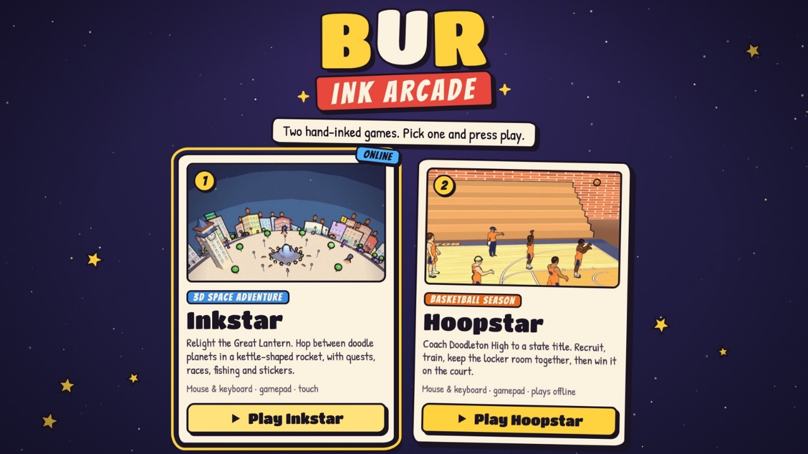

<picture>
  <source media="(prefers-color-scheme: dark)" srcset="assets/banner-dark.png">
  
</picture>

  <a href="https://burthebear.github.io"><b>Portfolio</b></a> ·
  <a href="https://burthebear.github.io/kodiak/"><b>Play my chess engine</b></a> ·
  <a href="https://github.com/BurTheBear/TypeParkinson-CAC"><b>TypeParkinson</b></a>

I like building things people can actually use. That includes an iPhone keyboard that adapts to hand tremor, a chess engine that searches about 2 million positions a second, and 3D games that run in a browser tab.

- **Now:** building **TypeParkinson** for the Congressional App Challenge 2026 with [@pranav-atreya10](https://github.com/pranav-atreya10)
- **Interested in:** algorithms and game AI, accessibility, graphics, and mobile apps
- **Also:** FBLA competitor (game design in Godot, video production)
- **Looking for:** a software engineering internship for summer 2027

## Featured work

<table>
  <tr>
    <td width="50%" valign="top">
      
      <h3>TypeParkinson</h3>
      
An iPhone and iPad keyboard for people with Parkinson's. It measures where each person's touches land, builds a keyboard around them, and keeps adapting as they type. It also has daily hand and voice check-ins, and a report to share with a care team.

      
<code>Swift</code> <code>SwiftUI</code> <code>Keyboard extension</code> <code>On-device ML</code>

      
<a href="https://github.com/BurTheBear/TypeParkinson-CAC">Code</a> · Congressional App Challenge 2026

    </td>
    <td width="50%" valign="top">
      
      <h3>Kodiak</h3>
      
A chess engine written from scratch with zero dependencies. It uses alpha-beta search, a transposition table, null-move pruning and quiescence search, and reaches depth 10–14 in two seconds. Its move generator is verified against published perft counts in CI.

      
<code>JavaScript</code> <code>Algorithms</code> <code>Web Workers</code> <code>CI</code>

      
<a href="https://burthebear.github.io/kodiak/">Play it</a> · <a href="https://github.com/BurTheBear/kodiak">Code</a>

    </td>
  </tr>
  <tr>
    <td width="50%" valign="top">
      
      <h3>QuickHelp</h3>
      
A micro-volunteering platform that matches 5–30 minute tasks with nearby volunteers. It has a mobile app, a realtime API and an admin dashboard. Streaks and leaderboards keep people coming back.

      
<code>TypeScript</code> <code>React Native</code> <code>Express</code> <code>PostgreSQL</code> <code>Docker</code>

      
<a href="https://github.com/BurTheBear/quickhelp">Code</a>

    </td>
    <td width="50%" valign="top">
      
      <h3>Starlink</h3>
      
An interactive presentation site with a full playable 3D adventure built in. You fly a kettle-shaped rocket between doodle planets. Custom ink-outline and crosshatch shaders give it a hand-drawn look.

      
<code>three.js</code> <code>GLSL shaders</code> <code>JavaScript</code>

      
<a href="https://burthebear.github.io/starlink/">Play it</a> · <a href="https://github.com/BurTheBear/starlink">Code</a>

    </td>
  </tr>
  <tr>
    <td width="50%" valign="top">
      
      <h3>Ink Arcade</h3>
      
A launcher for my browser games. It includes <b>Hoopstar</b>, a basketball season sim where you recruit, train and manage a team, then play the games on a 3D court. It runs fully offline.

      
<code>three.js</code> <code>Game design</code> <code>Web Audio</code>

      
<a href="https://burthebear.github.io/ink-arcade/">Play it</a> · <a href="https://github.com/BurTheBear/ink-arcade">Code</a>

    </td>
    <td width="50%" valign="top">
      <h3>More</h3>
      <ul>
        <li><b>The Great Pixel Adventure</b>: a 2D history adventure game in Godot (FBLA). Players time-travel to the 1910s and complete quests with historical characters.</li>
        <li><b>Chess Glasses</b>: computer vision that reads a real chessboard through Ray-Ban Meta glasses and tracks the game move by move.</li>
      </ul>
    </td>
  </tr>
</table>

## Tools I use

- **Languages:** Swift · JavaScript · TypeScript · Python · GDScript · HTML/CSS
- **Frameworks:** SwiftUI · React · React Native (Expo) · Node.js / Express · three.js · Godot
- **Data and infra:** PostgreSQL · Prisma · Redis · Docker · GitHub Actions
- **Tools:** Git · Xcode · Blender
