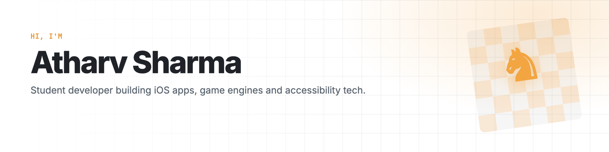
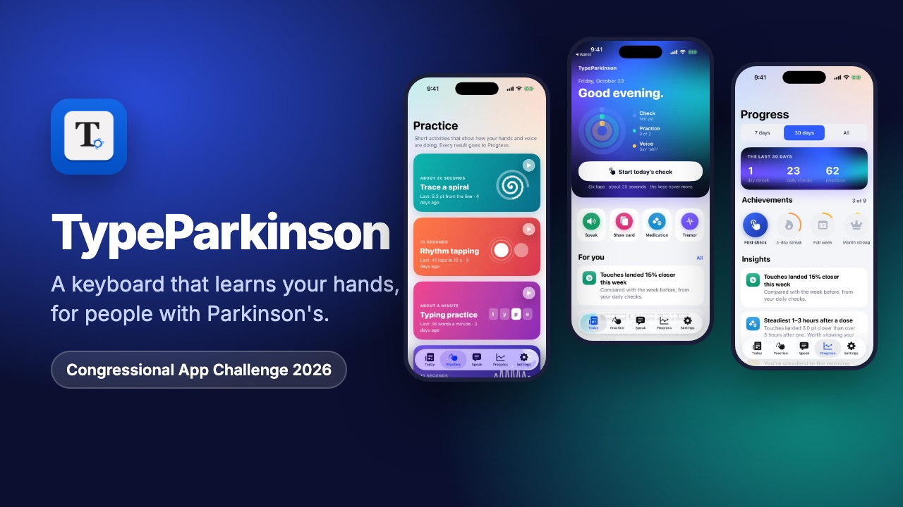
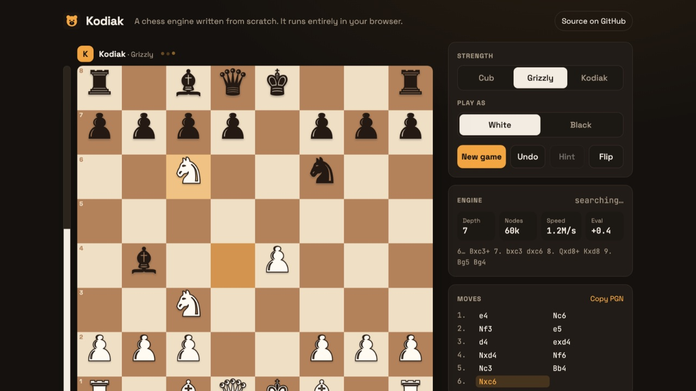
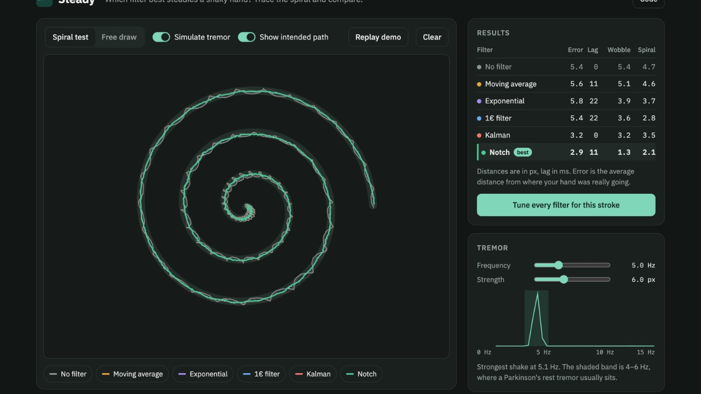
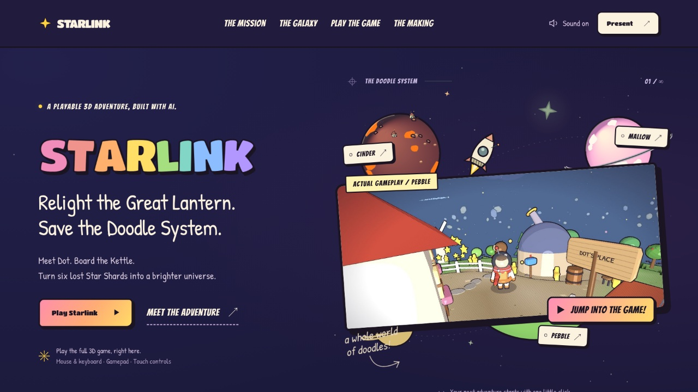
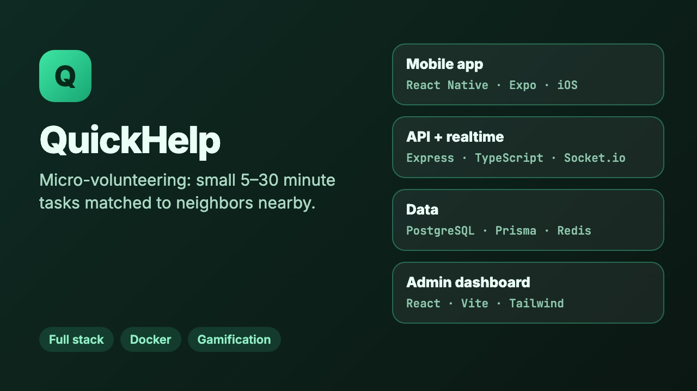
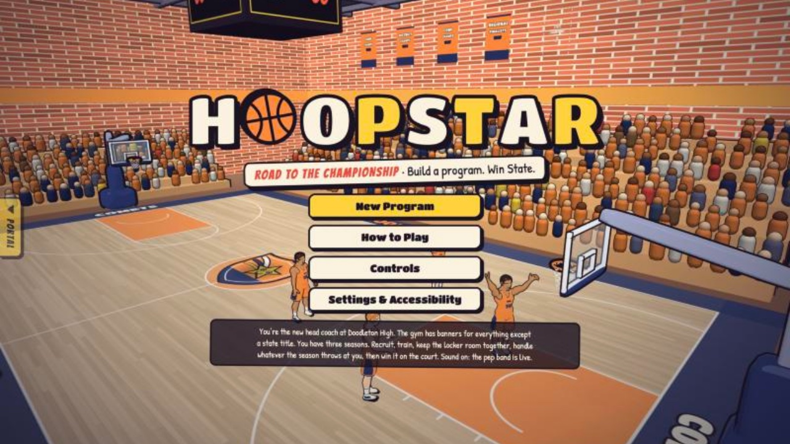

<picture>
  <source media="(prefers-color-scheme: dark)" srcset="assets/banner-dark.png">
  
</picture>

  <a href="https://burthebear.github.io"><b>Portfolio</b></a> ·
  <a href="https://burthebear.github.io/kodiak/"><b>Play my chess engine</b></a> ·
  <a href="https://github.com/BurTheBear/TypeParkinson-CAC"><b>TypeParkinson</b></a>

I like building things people can actually use. That includes an iPhone keyboard that adapts to hand tremor, a chess engine that searches about 2 million positions a second, and 3D games that run in a browser tab.

- **Now:** building **TypeParkinson** for the Congressional App Challenge 2026 with [@pranav-atreya10](https://github.com/pranav-atreya10)
- **Interested in:** algorithms and game AI, accessibility, graphics, and mobile apps
- **Also:** FBLA competitor (game design in Godot, video production)
- **Looking for:** a software engineering internship for summer 2027

## Featured work

<table>
  <tr>
    <td width="50%" valign="top">
      
      <h3>TypeParkinson</h3>
      
An iPhone and iPad keyboard for people with Parkinson's. It measures where each person's touches land, builds a keyboard around that, and keeps adjusting as they type. It also has daily hand and voice check-ins and a report to share with a care team.

      
<code>Swift</code> <code>SwiftUI</code> <code>Keyboard extension</code> <code>On-device ML</code>

      
<a href="https://github.com/BurTheBear/TypeParkinson-CAC">Code</a> · Congressional App Challenge 2026

    </td>
    <td width="50%" valign="top">
      
      <h3>Kodiak</h3>
      
A chess engine I wrote from scratch, with no libraries. It uses alpha-beta search with a transposition table, null-move pruning and quiescence search, and gets 10 to 14 moves deep in two seconds. The move generator is checked against published perft counts in CI.

      
<code>JavaScript</code> <code>Search</code> <code>Web Workers</code>

      
<a href="https://burthebear.github.io/kodiak/">Play it</a> · <a href="https://github.com/BurTheBear/kodiak">Code</a>

    </td>
  </tr>
  <tr>
    <td width="50%" valign="top">
      
      <h3>Steady</h3>
      
A side project from TypeParkinson. You draw with a simulated tremor and five filters try to steady it (moving average, exponential, 1€, Kalman and notch), scored on error, lag and leftover wobble.

      
<code>JavaScript</code> <code>Kalman filter</code> <code>FFT</code> <code>Canvas</code>

      
<a href="https://burthebear.github.io/steady/">Try it</a> · <a href="https://github.com/BurTheBear/steady">Code</a>

    </td>
    <td width="50%" valign="top">
      
      <h3>Starlink</h3>
      
A presentation site with a full 3D game inside. You fly a kettle-shaped rocket between doodle planets. Custom shaders make three.js look hand-drawn. It was built as an AI-assisted programming challenge: I directed the world, the design and the playtesting.

      
<code>three.js</code> <code>GLSL</code> <code>JavaScript</code>

      
<a href="https://burthebear.github.io/starlink/">Play it</a> · <a href="https://github.com/BurTheBear/starlink">Code</a>

    </td>
  </tr>
  <tr>
    <td width="50%" valign="top">
      
      <h3>QuickHelp</h3>
      
A micro-volunteering platform that matches small 5 to 30 minute tasks with nearby volunteers. It has a React Native app, an Express API with realtime updates, PostgreSQL through Prisma, and an admin dashboard.

      
<code>TypeScript</code> <code>React Native</code> <code>Express</code> <code>PostgreSQL</code> <code>Docker</code>

      
<a href="https://github.com/BurTheBear/quickhelp">Code</a>

    </td>
    <td width="50%" valign="top">
      
      <h3>Hoopstar</h3>
      
Coach a high school basketball team for three seasons: recruit, run practices, then play the games on a 3D court. It's one HTML file and works offline. It lives in my Ink Arcade with Inkstar.

      
<code>three.js</code> <code>Simulation</code> <code>Web Audio</code>

      
<a href="https://burthebear.github.io/ink-arcade/">Play it</a> · <a href="https://github.com/BurTheBear/ink-arcade">Code</a>

    </td>
  </tr>
</table>

**Also:** *The Great Pixel Adventure*, a 2D history adventure game in Godot for FBLA, and *Chess Glasses*, computer vision that reads a real chessboard through Ray-Ban Meta glasses and tracks the game move by move.

## Tools I use

- **Languages:** Swift · JavaScript · TypeScript · Python · GDScript · HTML/CSS
- **Frameworks:** SwiftUI · React · React Native (Expo) · Node.js / Express · three.js · Godot
- **Data and infra:** PostgreSQL · Prisma · Redis · Docker · GitHub Actions
- **Tools:** Git · Xcode · Blender
